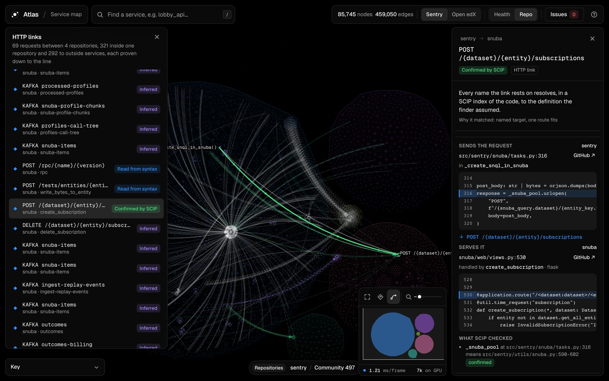
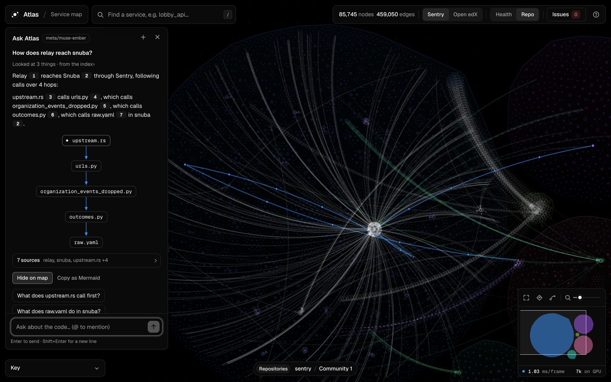

<div align="center">

# Atlas

**A zoomable, Google Maps-style map of a codebase or service graph.**

Repositories, domains, services, endpoints, and the contracts between them.
WebGL2 rendering stays smooth at 100,000 nodes. Builds to a single HTML file.
By default it shows its own source, indexed with tree-sitter and SCIP.

**[Live demo](https://atlas-demo-livid.vercel.app)** — Sentry's four repositories and Open edX, mapped by Graphify, with every HTTP call between them found in the code.

</div>


Click a link to see its proof: the line that sends the request, the route that serves it, and what SCIP confirmed.



Ask about the code in plain words. The answer cites the files it used, draws the route, and lights it on the map.



## Features

- Zoomable map of repositories, domains, services, endpoints, and the contracts between them
- Google Maps-style navigation, labels, and directions; WebGL2 stays smooth at 100,000 nodes
- One HTML file; default view is Atlas's own source, indexed with tree-sitter and SCIP
- Finds HTTP calls across repositories, and browser calls to the same repository's server routes
- Click a link for proof: the sending line, the serving route, and what SCIP confirmed
- Ask Atlas answers in plain words, cites the files it used, and lights the route on the map

[Quick start](#quick-start) · [Build from source](#build-the-page-from-source) · [Graphify](#graphify-graphs-on-the-map) · [HTTP links](#http-links-between-repositories) · [SCIP](#confirming-links-with-scip) · [Scores](#how-well-it-does) · [Frameworks](#supported-frameworks) · [Development](#development)

## Quick start

```bash
pipx install "git+https://github.com/LHopitalOne/atlas.git#subdirectory=bridge"   # Python 3.10+, no Node.js needed
atlas ./api ./web
```

This Graphifies each repository, finds the HTTP calls between them, and opens the map.
SCIP confirmation is on by default when an indexer can run (Node.js for Python and TypeScript, rust-analyzer for Rust). Pass `--no-scip` to skip it.

Everything lands in `atlas-out/`:

| File | What it is |
| --- | --- |
| `atlas.html` | The map, one file |
| `links.json` | Each link and why it was matched |
| `graph.json` | Graphify's graph with the links added, for `graphify path` / `query` |

A `graphify-out/graph.json` already in a repository is reused; `--refresh` rebuilds it.
`graph.json` is skipped when the merged graph has more than 200,000 nodes, unless you pass `--graph-json`.

One repository works too: its browser code is linked to its own server routes (`atlas ./sentry` finds 235; `--no-within` turns that off).

| Flag | What it does |
| --- | --- |
| `--refresh` | Run Graphify again even if `graphify-out/` exists |
| `--no-scip` | Do not index with SCIP |
| `--no-within` | Do not link a repository's browser code to its own server routes |
| `--alias word=repo` | A word in client code that means a repository, e.g. `upstream=sentry` (repeatable) |
| `--serve` | Show the map from a local server until Ctrl+C. Ask then reaches OpenRouter with `OPENROUTER_API_KEY`, and the key stays on this machine |

`atlas serve [atlas-out]` shows a map already written (`--port` defaults to 8780).

<details>
<summary><strong>More options</strong></summary>

| Flag | What it does |
| --- | --- |
| `--sandbox` | Index Python with SCIP in Docker |
| `--include-tests` | Also link requests made only by tests |
| `--group community` or `folder` | What becomes a domain (default: Graphify communities) |
| `--title` | Map title (default: the repository names) |
| `--graph-json` | Write `graph.json` even for graphs over 200,000 nodes |
| `--no-open` | Write the page without opening a browser |
| `--no-ask-key` | Leave `OPENROUTER_API_KEY` out of `atlas.html`. By default it is written in so Ask works by opening the file |
| `--jev` | Jev (OpenRouter; needs `OPENROUTER_API_KEY`) chooses among routes the rules already offered |
| `--read` | A small model (`meta/muse-ember` on OpenRouter; needs `OPENROUTER_API_KEY`) reads files the rules could not explain. Every claim is checked against the file |
| `--enrich` | The same model writes a one-sentence summary of each file |

`atlas --help` lists the rest.

</details>

## Build the page from source

```bash
npm install
npm run build                       # dist/atlas.html, dist/atlas-offline.html
open dist/atlas-offline.html
```

Show your own graph: `node scripts/build.mjs --offline --graph=my-graph.json` (format: [docs/GRAPH_SPEC.md](docs/GRAPH_SPEC.md)), or call `window.Atlas.loadGraph(spec)` in the page.

## Graphify graphs on the map

[Graphify](https://github.com/Graphify-Labs/graphify) turns a repository into `graphify-out/graph.json`.
`bridge/` (Python 3.10+; installs Graphify and the tree-sitter grammars for Python, Rust, JavaScript, and TypeScript) draws one or more of those on Atlas.
`atlas` above runs all of this; the steps one at a time:

```bash
graphify update path/to/repo                                   # writes path/to/repo/graphify-out/graph.json
python3 -m atlas_bridge spec path/to/repo/graphify-out/graph.json -o graph.json   # run from bridge/
node scripts/build.mjs --offline --graph=bridge/graph.json
```

| Graphify | On the map |
| --- | --- |
| Files | Services |
| Functions and classes | Leaves |
| Communities | Domains (`--group folder` uses folders instead) |
| EXTRACTED / INFERRED / AMBIGUOUS tags | Atlas's link colours |

Pass several graphs (`api=a/graph.json web=b/graph.json`), or one built with `graphify merge-graphs`, and each repository gets its own territory.

## HTTP links between repositories

Graphify maps each repository on its own; `graphify merge-graphs` puts several side by side.
`links` finds the HTTP requests one repository sends to routes another serves, and adds them as edges:

```bash
pip install ./bridge                                # Graphify, tree-sitter and its Python, Rust, JavaScript, TypeScript grammars
graphify merge-graphs api/graphify-out/graph.json web/graphify-out/graph.json --out merged.json
python3 -m atlas_bridge links api web --graph merged.json --graphify-out merged-links.json -o links.json
graphify path "placeOrder()" "POST /orders" --graph merged-links.json   # Graphify now crosses repositories
python3 -m atlas_bridge spec merged-links.json -o graph.json             # and so does the Atlas map
```

Each link says how sure it is:

| Status | Meaning |
| --- | --- |
| **matched** | A named service, and one route fits |
| **inferred** | No name; a route behind a prefix the base URL is assumed to carry, or a URL made absolute and handed to another service to fetch |
| **ambiguous** | Several routes fit |
| **unmatched** | The named service has no such route |

Requests made only by tests are left out unless `--include-tests`.
The finder is careful but narrow: it rarely links wrongly, and it misses requests written in a way it was never taught.

<details>
<summary><strong>How links are matched</strong></summary>

1. **Read the servers.** List every route each repository serves, and every queue or topic it consumes (Celery tasks, Kafka topics).
2. **Read the clients.** List every request each repository sends, with its path and the clues near it about where it goes, such as a base URL called `CATALOG_API_URL`.
3. **Match them.** The first rule that applies decides:
   - **Payload:** the request names a route instead of giving a path.
   - **Named target:** a clue names another service (in a variable name, an `--alias`, or a URL in configuration). That service's route whose path fits is taken, also behind a short prefix like `/api/v1`.
   - **Path only:** nothing names a service. The path counts only if it fits another repository's route word for word, has at least two fixed words, and fits nothing in its own repository.
   - Queues and topics are matched by the name they share.
4. **Leftovers.** A request to an outside host is marked outside. Anything else stays unmatched or ambiguous; the finder never guesses.
5. **Optional AI steps.** `--read` has a model read the files the rules could not explain. The code checks every claim against the file (the quoted line exists, and the path's words are written there) and then matches it with the same rules. `--jev` has a model choose among routes the rules already offered; it never invents one.

It follows URLs through wrapper functions back to the literal path, through helpers that return a URL (`getBookmarksBaseUrl()`, `self._make_url(path)`), URL objects (`new URL(...).href`), `urljoin`, and Django settings (`settings.LMS_API_URLS['blocks']`).

The target service comes from names near the request (`_snuba_pool`, `SymbolicatorSession`, `--alias upstream=sentry`) and from where configuration says services live. Settings modules, `.env` files and docker-compose files name URLs (`COURSE_CATALOG_API_URL = 'http://edx.devstack.discovery:18381/api/v1'`, `LMS_BASE_URL='http://localhost:18000'`, a compose service publishing `18381:18381`), so a request to `localhost:18381`, `10.0.0.5:18381`, a Docker DNS name or a configured setting reaches the service that address belongs to.

- `localhost` and bare IPs only count with their port.
- An address two services claim counts for neither.
- When a base URL carries part of the path, a route behind a short API prefix (`/api/v1`) fits, preferring the prefix configuration names, then one the base URL's name mentions (`lms_coursemode_api_url` -> `/api/course_modes/v1`).

</details>

<details>
<summary><strong>How links are written into the Graphify graph</strong></summary>

The links use the same shape as Graphify's own HTTP endpoints: the calling function `calls_endpoint` an `http_endpoint` node, and that node `serves` the handler (when the graph has exactly one function of that name). Each edge's `metadata.atlas` keeps why it was matched.

`graphify affected` follows them only when asked:

```bash
graphify affected "post_order()" --relation calls_endpoint --relation serves --relation calls
```

</details>

## Confirming links with SCIP

A link rests on names the finder resolved without a compiler: the client a request goes through (`_snuba_pool` here is the pool defined at `snuba.py:590`), each wrapper call it followed back to the literal path, the request trait a Rust type implements.
[SCIP](https://github.com/sourcegraph/scip) indexes record where every name really points, so they can check those guesses:

```bash
python3 -m atlas_bridge index sentry relay snuba symbolicator -o scip      # scip-python, rust-analyzer, scip-typescript
python3 -m atlas_bridge links sentry relay snuba symbolicator --alias upstream=sentry --scip-dir scip -o links.json
```

| Status | Meaning |
| --- | --- |
| **confirmed** | Every name the link rests on resolves where the finder assumed |
| **syntax** | It rests on no name lookup: read straight from the code |
| **contradicted** | A name resolves elsewhere |
| **unverified** | The indexes could not check it |

The indexers never run the repositories' code: scip-python and scip-typescript only type-check, and rust-analyzer runs with build scripts and procedural macros switched off. SCIP files are read without a protobuf dependency. What no index can confirm is configuration: which host a base URL points to when the code runs.

<details>
<summary><strong>Sandbox indexes, client libraries, and in-repo frontend links</strong></summary>

Without the repository's libraries installed, an index cannot say where a call into them goes (`requests`, Django, a client SDK). `index --sandbox` (needs Docker) indexes Python in a throwaway container instead: the repository is mounted read-only, the libraries it declares (requirements files, `pyproject.toml`, Poetry) are installed there, where install scripts can do no harm, and only the index is written back. On Label Studio this takes the libraries the index resolves from none to 55.

Services often talk through a client library that lives in a repository of its own (an SDK): the service calls `ls.tasks.get(id)` and the HTTP request is built inside the SDK. `links --library sdk=folder` reads the library too, and, with SCIP indexes of every repository, walks from each request the library sends up through the library's own functions to the service lines that call into it, where the request is reported. Each call followed is an assumption the indexes check, across repositories: `model.py:291 -> TasksClient.get -> RawTasksClient.get -> GET /api/tasks/{id}/`.

```bash
python3 -m atlas_bridge index --sandbox -o scip label-studio label-studio-ml-backend label-studio-sdk
python3 -m atlas_bridge links label-studio label-studio-ml-backend --library label-studio-sdk --scip-dir scip -o links.json
```

Most products keep their frontend and backend in one repository. `links --within` also links browser code to its own repository's server routes: a request to a relative path goes to the origin that served the page. It needs every fixed word of the path to meet a route's (a catch-all page route never takes it), and a generic helper that requests `/api/0/{anything}` is linked only when one route fits. On Sentry alone that is 235 frontend-to-backend links, on Label Studio 9; these have no answer key yet, so they are not in the scores below.

With SCIP indexes, Python extraction also asks them first wherever it would otherwise go by names: a call is a request when it resolves into an HTTP library (`requests`, `httpx`, `aiohttp`, `urllib3`) and not one when it resolves into another library (`dict.get`, Django's test client), and a wrapper's callers are every call the index resolves to it, in any file, even under a common name like `get`. Where the index knows nothing, or a call reaches the repository's own code (often a `*args, **kwargs` pass-through the URL cannot be followed through), the name rules decide as before; `--no-scip-search` keeps them alone. On the four answer keys it finds exactly the same links (their requests were already read right by name); JavaScript and Rust still go by names.

</details>

## How well it does

`eval/sentry/` and `eval/openedx/` are answer keys of the real links between four Sentry services and four Open edX ones (the second built after the finder was tuned on the first, to test whether it generalises). `eval/labelstudio/` is a held-out key the frozen finder was run on once. `eval/mozilla/` was held out too, and is now a practice set: the finder was fixed on what it missed there.

[`eval/README.md`](eval/README.md) links every repository the keys cover at its pinned commit, with the commands to fetch it and reproduce each score. `eval/score.py` scores a run:

```bash
python3 -m atlas_bridge links sentry relay snuba symbolicator --alias upstream=sentry -o links.json
python3 eval/score.py eval/sentry/answer-key.json links.json
```

| | Sentry | Open edX | Label Studio (held out) |
| --- | --- | --- | --- |
| Production links found | 20 / 20 | 61 / 71 (12 / 71 before the held-out fixes) | 6 / 15 (3 / 15 frozen; 4 / 4 sent by the services' own code, 2 / 11 sent through the SDK, traced with `--library`) |
| False links | 0 | 0 (31 before) | 0 |

<details>
<summary><strong>How far to trust these scores</strong></summary>

Each fix was made because a key showed a miss, so the sets the finder was fixed on (Sentry, Open edX, the dev set, the small apps, Mozilla) show how it does on code already studied. The honest measure for new code is a key nobody tuned on: Label Studio, 4 / 15 without `--library`, and a sealed test kept outside this repository, 16 / 112 with the rules alone and 28 / 112 with `--read`. The gap is overfitting. The fixes are general patterns (versioned API mounts, nested routers, request wrappers) and moved no other set when added, but each new codebase still brings ways of writing requests the finder has not seen. [`eval/README.md`](eval/README.md) has every score.

`eval/score.py` once credited a key link when a found link's route sat within 3 lines of it, even when that found link was another key link's route; it no longer does, which took Open edX from 68 to 61 (the finder sends Discovery's list requests to the detail route, and five catalog links had been credited for a neighbouring course route).

</details>

## Supported frameworks

Routes, requests, queues and topics are read from source with tree-sitter (Python, Rust, JavaScript, TypeScript, and TSX).

| | Routes | Requests |
| --- | --- | --- |
| Python | Django URLconfs with includes, DRF routers and their `@action`s, plugin URL configs, Flask and FastAPI decorators | urllib3, requests, httpx |
| JavaScript / TypeScript | Express, Koa-router, Fastify, Hono, Next.js (`pages/api/`, `app/**/route.ts`), NestJS, GraphQL resolver maps, tRPC routers | fetch, axios, HTTP clients, data-fetching hooks, GraphQL operations, tRPC clients |
| Rust | axum and actix routers | reqwest, and request types that declare their own path |

Queues and topics: Celery tasks and Kafka topics.
SCIP confirmation uses scip-python, scip-typescript (TypeScript and JavaScript), and rust-analyzer.

## Graph format

The JSON Atlas reads is specified in [docs/GRAPH_SPEC.md](docs/GRAPH_SPEC.md). See also [docs/ARCHITECTURE.md](docs/ARCHITECTURE.md), [docs/INTEGRATION.md](docs/INTEGRATION.md), [docs/DECISIONS.md](docs/DECISIONS.md), and [docs/DEMO.md](docs/DEMO.md).

## Development

| Command | What it does |
| --- | --- |
| `npm run build` | Bundle `src/` with esbuild into the two single-file pages |
| `npm test` | Unit and architecture tests (Node's test runner) |
| `npm run test:coverage` | Unit tests with 75% line, branch and function coverage gates |
| `npm run lint:imports` | The layer rules only (`test/architecture.test.js`) |
| `npm run test:e2e` | Browser tests with Playwright (set `CHROMIUM_PATH` to use a specific Chromium) |
| `npm run lint` | ESLint |
| `npm run check` | Lint, import rules, unit tests with coverage, build, end-to-end tests |
| `npm run index:self` | Re-index Atlas's own code into `generated/self-graph.json` |

`.github/workflows/ci.yml` runs on every push to `master` and every pull request:

| Job | Checks |
| --- | --- |
| JS lint and import rules | ESLint, Prettier, the layer rules in `test/architecture.test.js` |
| JS unit tests | Node's test runner; fails under 75% line, branch or function coverage |
| Bridge | Ruff lint and format, import-linter contracts, unit tests; fails under 75% coverage |
| Integration | Real Graphify on `bridge/tests/fixtures/shop`, through the bridge, into Atlas's validator, equal to the golden spec |
| E2E | Playwright on the built page, including a Graphify graph drawn from the golden spec |

```bash
cd bridge && pip install -r requirements-dev.txt
ruff check . && ruff format --check . && lint-imports
coverage run -m unittest discover -s tests -t . && coverage report      # fails under 75%
ATLAS_INTEGRATION=1 python -m unittest discover -s tests/integration -t .  # real Graphify, pinned version
```

<details>
<summary><strong>Bridge architecture</strong></summary>

The bridge follows the dependency rule of clean architecture; `lint-imports` enforces it:

| Ring | Module | May import |
| --- | --- | --- |
| Entities | `core/model.py`: files, symbols, links, link certainty | the standard library, no I/O |
| Entities | `core/http.py`: path templates, routes, requests, how well a request fits a route | the standard library, no I/O |
| Entities | `core/addresses.py`: service URLs configuration names, hosts and ports | the standard library, no I/O |
| Use cases | `usecases/draw.py`: arrange a code graph as repos > domains > files | `core` |
| Use cases | `usecases/link.py`: match requests to other repositories' routes; the `Extractor` port | `core` |
| Use cases | `usecases/addresses.py`, `usecases/bases.py`: which service an address or setting points at, which prefix a base URL carries | `core` |
| Adapters | `adapters/graphify.py` (graph.json in and out), `adapters/atlas.py` (Atlas spec out), `adapters/treesitter/` (routes and requests from source), `adapters/linkfile.py` (links JSON) | `usecases`, `core`; never each other |
| Driver | `__main__.py`: command line, files, wiring | everything |

`bridge/tests/test_architecture.py` and ruff enforce these in CI:

- `__init__.py` files only import and export (a docstring, imports, `__all__`).
- Modules stay under 300 lines, classes under 250, functions under 50, cyclomatic complexity at most 10.
- Object-oriented: abstract bases with concrete subclasses (`Command`, `Presenter`, `Grouping`, `LinkRule`, `LanguageExtractor`, `Workspace`, `RouteCollector`, `CallCollector`, `ValueResolver`, `TestPathPolicy`), state kept private behind methods.
- Every error is a subclass of `BridgeError` from `core/errors.py`; the command line turns them into a message and an exit code (2 for input the user can fix).
- Every regex is a named, compiled, commented constant; nothing calls `re.sub(r'...')` inline.

</details>

<details>
<summary><strong>Repository layout</strong></summary>

```
src/
  main.js            entry: support check, init order, boot, Atlas.loadGraph
  state.js config.js dom.js index.html
  util/              math, format (pure), dom (browser)
  model/ graph/      generation, spec validation, layout, indexes, route search (pure, Node-testable)
  render/            WebGL2 layers, frame loop, overlay, labels, minimap
  app/               camera, focus, selection, routes, URL, keyboard and pointer input
  ask/               questions about the code: shared lookup tools, offline answers, Claude engine
  ui/                panels: inspector, directions, search, key, needs attention, ask, controls
test/                unit + architecture tests; test/e2e/ Playwright
tools/index-self/    tree-sitter + SCIP indexer for the Self graph
docs/                DECISIONS, ARCHITECTURE, GRAPH_SPEC, INTEGRATION, DEMO
bridge/              Python: Graphify graph.json to Atlas (core, usecases, adapters, CLI)
eval/README.md       every answer key's code (repositories at pinned commits) and how to reproduce each score
eval/sentry/         answer key: verified HTTP links between Sentry's repos, for scoring the link finder
eval/openedx/, eval/labelstudio/  more answer keys, built without the finder (see each README)
```

See `CLAUDE.md` for the rules the code follows.

</details>

## Licence

Apache-2.0. See [LICENSE](LICENSE).
